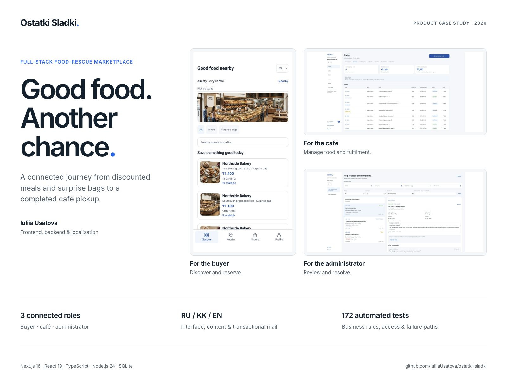
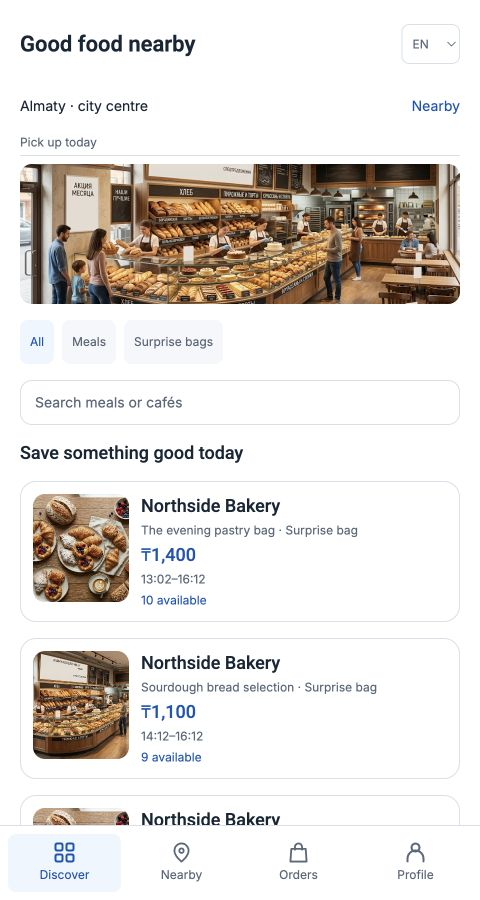
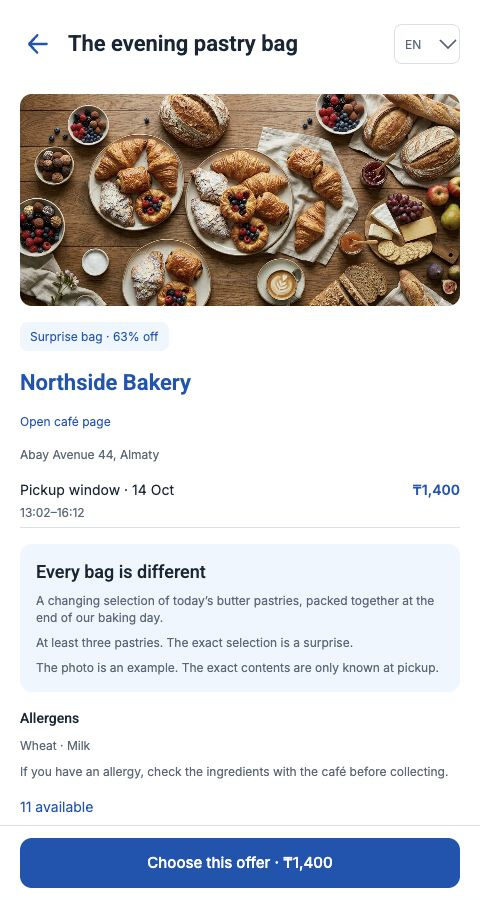
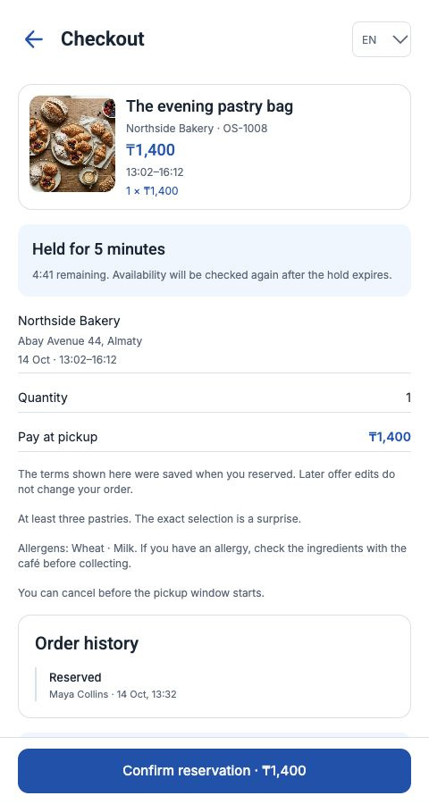
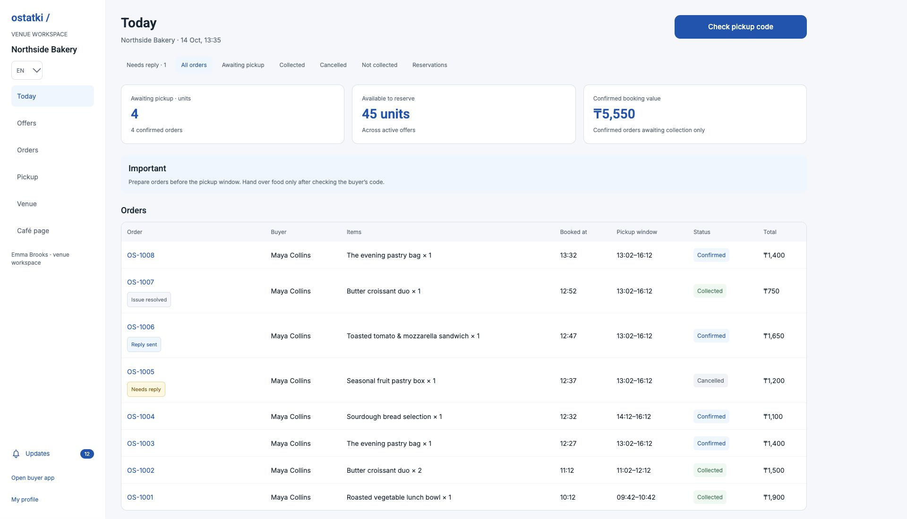
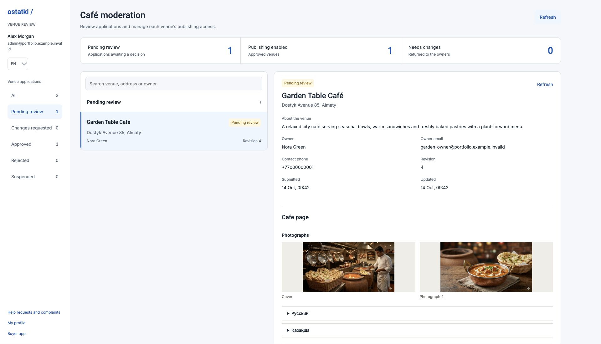
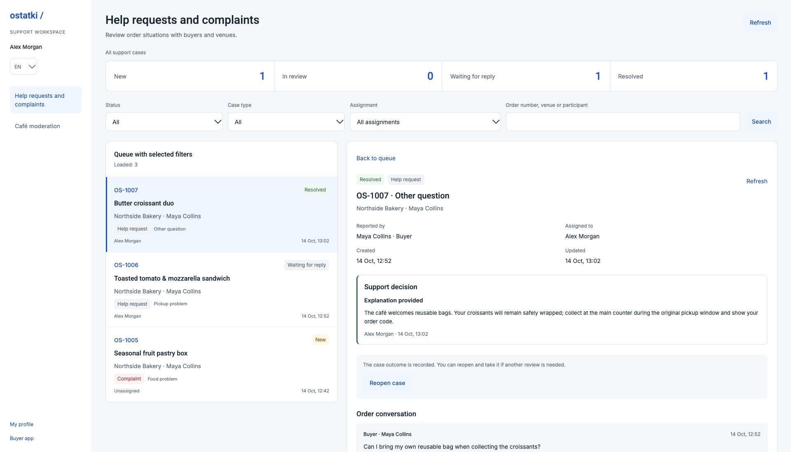

<div align="center">

# Ostatki Sladki

### Good food. Another chance.

A full-stack food-rescue marketplace connecting local cafés with people looking for discounted meals and surprise bags.

**Next.js 16 · React 19 · TypeScript · Node.js 24 · SQLite**

**English · Қазақша · Русский**

[Explore the complete case study](docs/portfolio-case.md) · [Architecture](docs/architecture.md) · [Verification](docs/verification.md)



</div>

## The product

Unsold food is time-sensitive inventory. A useful marketplace has to coordinate availability, booking deadlines, pickup, café approval and the people handling a problem after an order.

Ostatki Sladki covers that entire journey: a buyer finds a meal or surprise bag, reserves it and collects it at the café; the café manages its offers and handoff; an administrator reviews venues and resolves order-related support cases. These workspaces share a working Node backend and persistent storage.

The product began as a joint initiative with UX/UI designer **Aleksandr Evstratenko**. The application follows the [original Figma designs](https://www.figma.com/design/8FZnmYn4ihOn7q1eHQxxfH?node-id=2010-526) and extends them into complete operational flows. **Iuliia Usatova** implemented the frontend, backend, localization and automated verification.

## Three roles, one connected workflow

| Buyer                                              | Café owner                                             | Administrator                                              |
| -------------------------------------------------- | ------------------------------------------------------ | ---------------------------------------------------------- |
| Discover meals, surprise bags and nearby cafés     | Apply, correct an application and submit it for review | Review the exact submitted café revision                   |
| Read allergens, guarantees and pickup instructions | Edit RU/KK/EN offers, price, stock and pickup windows  | Request changes, approve, reject or suspend a venue        |
| Reserve for up to five minutes, then confirm       | Upload photos and maintain the public café page        | Inspect photos, translations, hours and review history     |
| Collect using a private six-digit pickup code      | Look up the code and explicitly confirm handoff        | Claim support cases, reply and record a decision           |
| Follow order history, messages and notifications   | Handle cancellations and buyer conversations           | Keep multilingual explanations and a shared action history |

Payment is due **at pickup**. Booking confirmation does not charge a card; online payments, settlement and refunds are separate future work.

## Inside the application

The complete [visual walkthrough](docs/portfolio-case.md) includes **24 English screenshots and eight storyboards**, following discovery → reservation → pickup → support, then café operations and administrator review. All screenshots use fictional account and venue data.

| Discover food                                                                             | Understand the offer                                                                          |
| ----------------------------------------------------------------------------------------- | --------------------------------------------------------------------------------------------- |
|  |  |
| Buyers can search and filter offers, or explore approved nearby cafés.                    | The offer explains what is guaranteed and when collection is available.                       |

| Confirm a booking                                                                          | Run the café                                                                     |
| ------------------------------------------------------------------------------------------ | -------------------------------------------------------------------------------- |
|  |  |
| A temporary hold protects stock while the buyer confirms.                                  | Owners manage availability, bookings and outstanding conversations.              |

| Moderate a venue                                                                                         | Resolve an order problem                                                                               |
| -------------------------------------------------------------------------------------------------------- | ------------------------------------------------------------------------------------------------------ |
|  |  |
| Approval applies to a specific submission, including its photos and translations.                        | Assignment, replies and decisions remain visible in the case history.                                  |

## Engineering decisions

| Problem                                             | Implementation                                                                                                                                            |
| --------------------------------------------------- | --------------------------------------------------------------------------------------------------------------------------------------------------------- |
| Two buyers want the last item                       | SQLite checks capacity and reserves it for up to five minutes in one transaction, capped by the pickup deadline.                                          |
| A request succeeds, but its response is lost        | Keyed actions save the original payload and attempt key before sending. Matching retries replay the recorded result rather than create another operation. |
| A café changes an offer after booking               | Orders retain immutable prices, translations, address, allergens, guarantees and pickup windows.                                                          |
| An owner edits a profile while it is being reviewed | Moderation checks the submission revision. A stale decision cannot approve a newer profile.                                                               |
| A page needs the same data in several places        | Concurrent subscribers share only an in-flight GET. Writes invalidate pending reads; completed data is not retained in a hidden global cache.             |
| A reminder must run without an open browser         | A supervised Node worker processes durable reminder and order-email jobs every 15 seconds.                                                                |
| Uploaded photos must respect venue and order access | Sharp validates and normalizes images; private files are served through current authorization checks.                                                     |
| A feature grows beyond one screen                   | FSD public entries and an AST-based dependency guard keep browser boundaries enforceable in CI.                                                           |

The server applies current identity and role checks, mailbox requirements, ownership, stock and pickup-window rules to the relevant operations. TypeScript DTOs describe the contract; runtime validation and authorization enforce it.

### Architecture

The frontend uses **Feature-Sliced Design**. The backend is a **modular monolith** with focused use cases and a SQLite infrastructure layer. Single responsibility and narrow collaborator contracts keep rules, persistence and visual components separate without adding a generic CRUD framework.

```text
src/
├── app/                         Next.js pages, layouts and HTTP route adapters
├── _app/                        Application providers
├── _pages/                      Screen composition and page controllers
├── widgets/                     Composed café editor and order discussion
├── features/                    Offer editing, collection, support, preferences
├── entities/                    Offer, order, venue and notification presentation
├── shared/                      Transport contracts, i18n, UI and browser utilities
├── domain/                      Server validation and domain entry points
└── server/
    ├── modules/                 Authorization, sessions and marketplace use cases
    └── infrastructure/sqlite/   Connection, migrations, queries and commands
```

Browser imports follow `_app → _pages → widgets → features → entities → shared`. Next.js adapters in `src/app` sit outside that chain. Peer slices cannot import each other; cross-slice consumers use public entries. The guard also checks type imports, cycles and browser imports of server-only code.

Read [ADR 001](docs/adr/001-fsd-and-modular-backend.md) for the boundary choices, retry protocol and trade-offs. The initial React/Vite foundation is preserved in `legacy/vite`.

### Localization

English is the initial language; the selected language persists. RU/KK/EN covers the buyer, café and administrator interfaces, errors, transactional emails and moderation/support explanations. Café profiles and offers require all three content translations. Orders preserve those translations as part of their original terms; free-form conversations retain the author's language.

Prices are in **KZT**. Instants are stored in UTC and displayed in **Asia/Almaty** time. Automated checks verify dictionary keys and placeholders across all three languages.

## Run locally

Use **Node.js 24** and **pnpm 11.9**. The web application and API run in the same project.

```sh
pnpm install --frozen-lockfile
pnpm dev
```

Open [localhost:3103](http://localhost:3103). Development enables fictional catalogue fixtures. New production and unconfigured standalone databases start empty; existing databases are preserved. Fixture pickup windows are set on first creation; café owners can edit an offer's window when it has expired.

For a local production build, stop the development server first:

```sh
pnpm build
pnpm start
```

`pnpm dev` and `pnpm start` supervise both Next.js and the notification worker. Stopping the command stops both. Running `next start` directly starts only the web process, so scheduled work will not run.

### Accounts and administrator access

Register a buyer or café account at `/register`. Registration does not permit choosing an administrator role. Café applications remain pending until review; changes to an approved public profile start another review.

To provision an administrator, first register a buyer account and confirm its email, then run this trusted local operation from the project folder:

```sh
node scripts/grant-admin.ts --email YOUR_EMAIL
```

Sign in again after the grant: privilege changes revoke existing sessions. Verified administrators use `/admin` for café moderation and `/admin/support` for support. An administrator grant does not substitute for mailbox confirmation.

### Email

Browsing and local startup work without a mail provider. Verification, password recovery and real order-email delivery require a confirmed **Brevo** sender and a privately configured API key:

```sh
python3 scripts/setup-email.py
```

The script uses hidden key input and writes `data/email-settings.json`, excluded from Git. Keep credentials and email capability links out of commits and bug reports. Follow [email delivery setup](docs/email-delivery.md) for provider preparation and inbox checks.

Registration remains saved when its first email cannot be submitted. Unverified accounts can browse and access their existing work, but cannot create/confirm bookings, create/edit selling offers or enter administrator moderation. Confirmation and reset use expiring, single-use links and revoke existing sessions; neither signs the user in automatically.

Security-email submission belongs to the initiating request and requires an explicit retry after failure. Order emails use a separate persistent outbox with bounded retries. Provider acceptance and inbox delivery are distinct results.

### Persistent data

The default database is `data/ostatki.sqlite`. Uploaded photographs live in its companion `data/ostatki.sqlite.photos` directory. Both are private, excluded from Git and must be preserved together.

`OSTATKI_DATABASE_FILE` selects a separate database for isolated testing or a persistent volume. A public HTTPS deployment must also set the exact `OSTATKI_PUBLIC_ORIGIN`; forwarded headers do not define the trusted origin. See [storage and access rules](docs/venue-media.md) and [architecture](docs/architecture.md) before changing the deployment model.

## Verification

```sh
pnpm check
pnpm format:check
```

`pnpm check` runs the architecture guard, strict TypeScript, ESLint, the Node test suite and a production build. GitHub Actions repeats these checks and formatting on pushes and pull requests.

The latest recorded verification passed **172 automated tests**, plus browser regression of offer editing, booking, pickup, café resubmission, moderation and support decisions in all three languages. Tests use isolated databases, explicit fixtures, injected clocks and mail transports.

Coverage includes concurrent reservations, expiry boundaries, stock release, lost-response retries, role/ownership checks, session revocation, email capabilities, moderation revisions, private photo access, support assignment/reopening, background notifications and localization parity. See the [verification record](docs/verification.md#fsd-and-module-refactor-regression-2026-10-14) for the evidence and its limits.

## Technical reference

| Area                 | Documentation                                                                                    |
| -------------------- | ------------------------------------------------------------------------------------------------ |
| Architecture and FSD | [System boundaries](docs/architecture.md) · [ADR 001](docs/adr/001-fsd-and-modular-backend.md)   |
| Accounts and cafés   | [Authentication and moderation](docs/auth-moderation.md) · [Email setup](docs/email-delivery.md) |
| Booking and pickup   | [Order lifecycle and conversations](docs/order-lifecycle.md)                                     |
| Support              | [Cases, assignment, decisions and HTTP contracts](docs/support.md)                               |
| Media and discovery  | [Café pages and photographs](docs/venue-media.md) · [Nearby search](docs/nearby.md)              |
| Background work      | [Notifications, reminders and email jobs](docs/order-notifications.md)                           |
| Validation           | [Automated and browser checks](docs/verification.md)                                             |

## Current boundaries

This repository presents a working application through source code, local setup and a [complete screenshot case study](docs/portfolio-case.md). It is not currently publicly hosted.

Online payments/refunds, support-email notifications and production backup operations remain release work. The Node web process and worker share a durable SQLite disk and private photo storage; stateless edge hosting or independent replicas require an architectural change. Public use also needs HTTPS, the trusted origin, clean venue data, coordinated backups and delivery/link checks against the final hostname.

---

**Built by [Iuliia Usatova](https://github.com/IuliiaUsatova)** — frontend engineering, full-stack workflows and operational product systems.
