# Ostatki Sladki — from surplus food to a completed pickup

**Full-stack marketplace · Buyer, café and administrator workflows · English / Kazakh / Russian**

Ostatki Sladki helps local cafés offer unsold meals and surprise bags at discounted prices. Buyers see the original terms, reserve available stock and collect within a defined pickup window. Café owners manage food, photographs and bookings; administrators review cafés and handle order problems through a recorded support process.

I implemented the React/Next.js interface, Node backend, SQLite persistence, authentication, localization and verification. The product began as a joint initiative with UX/UI designer Aleksandr Evstratenko; its visual foundation comes from the [original Figma file](https://www.figma.com/design/8FZnmYn4ihOn7q1eHQxxfH?node-id=2010-526).

The **24 screenshots and eight storyboards** below show the working English interface with fictional café and account data. Prices are in KZT and pickup times use Almaty time. This is a source-and-screenshot case study; the application is not currently publicly hosted.

[Discovery](#1-find-food-worth-collecting) · [Booking and pickup](#2-reserve-confirm-and-collect) · [Support](#3-get-help-when-an-order-needs-attention) · [Café operations](#4-operate-a-café) · [Administration](#5-review-cafés-and-resolve-cases) · [Engineering scope](#engineering-scope)

<strong>Presentation gallery — eight storyboards</strong>

### Discovery

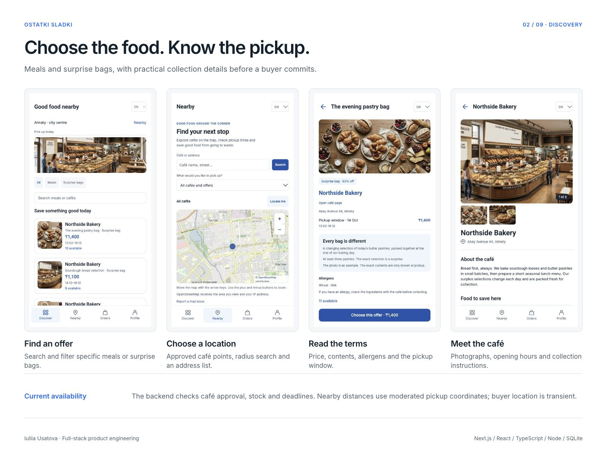

### Booking

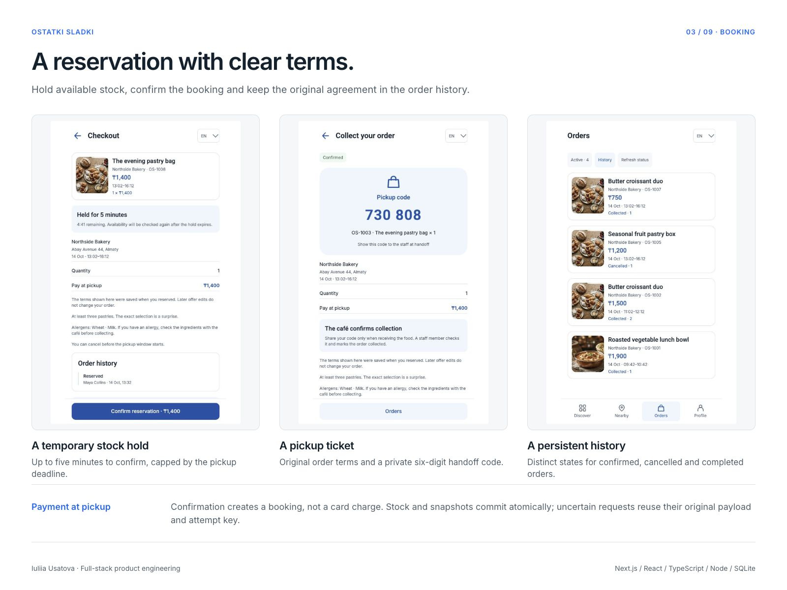

### Handoff and notifications

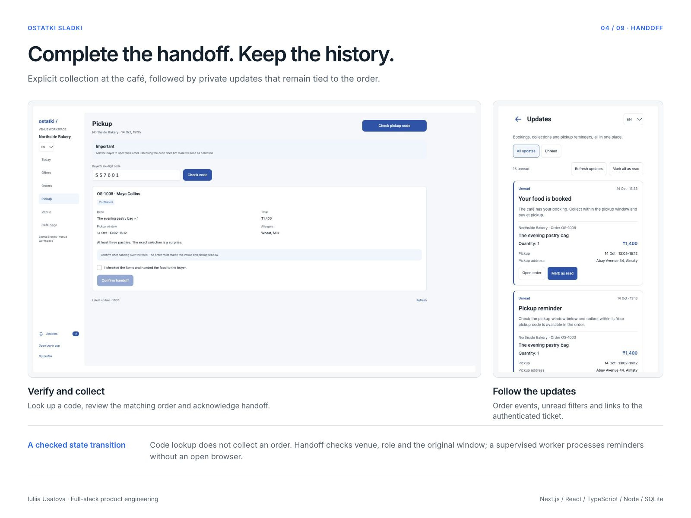

### Café operations

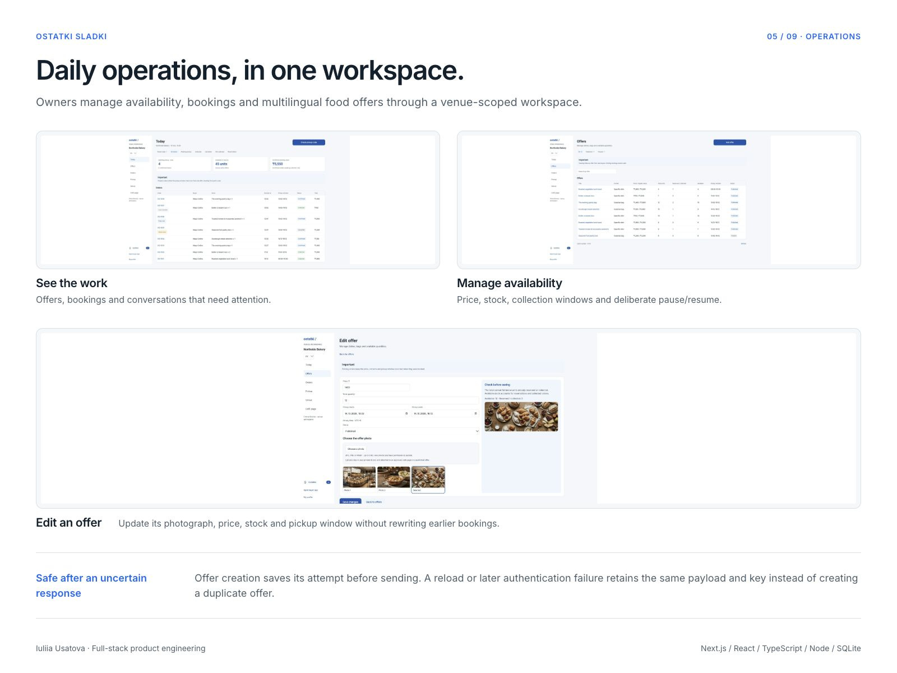

### Café profile

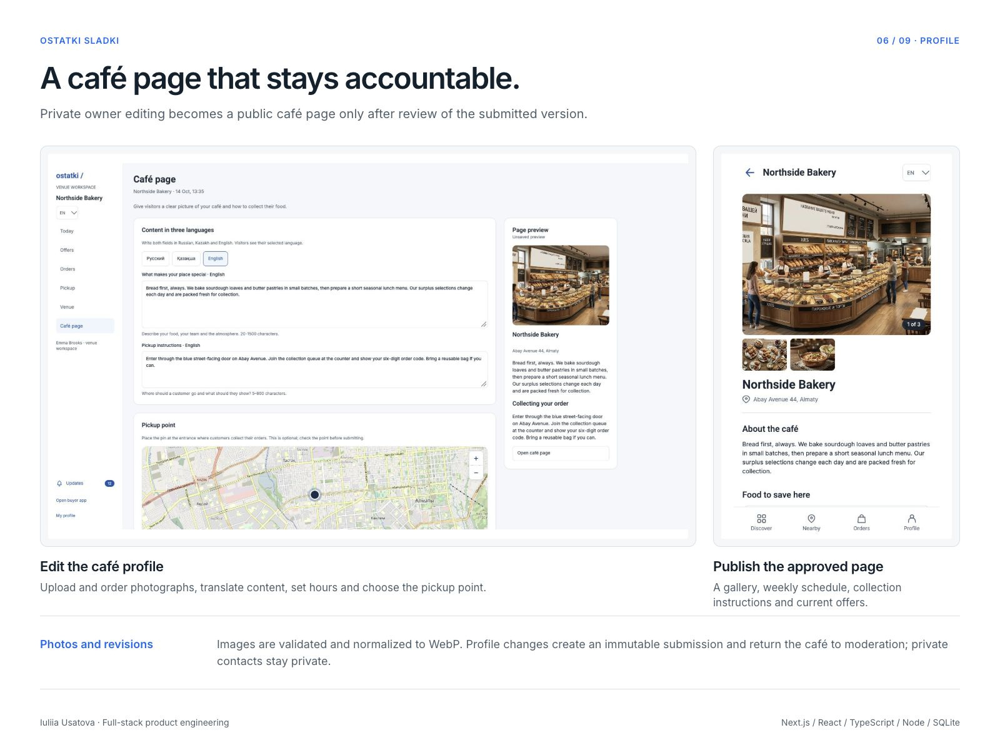

### Moderation

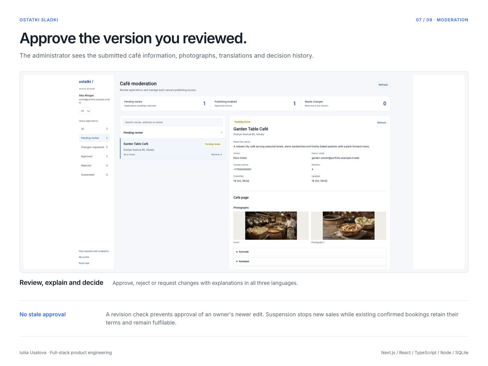

### Support

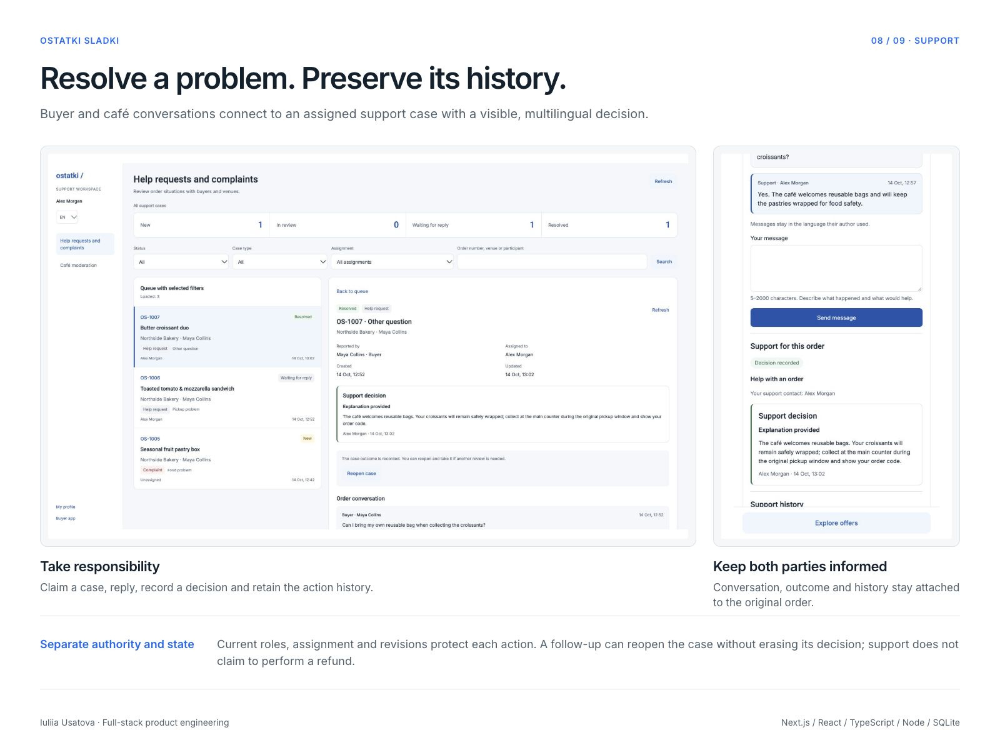

### Account access

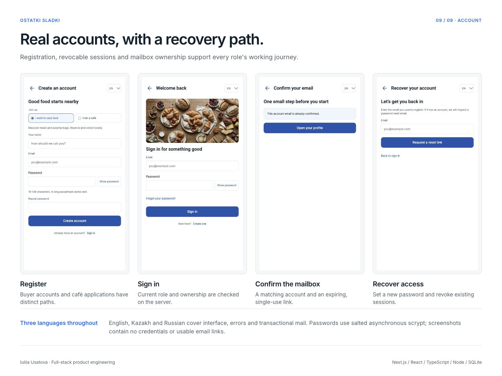

<strong>Account access and security — registration, sign-in, confirmation and recovery</strong>

### Register for the right workspace

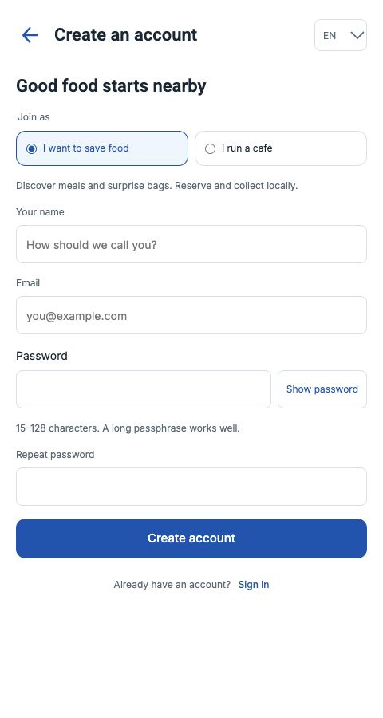

Registration distinguishes a buyer account from a café application. The café path collects the business details needed for review; administrator privileges cannot be self-selected. The account is saved even when the first confirmation email cannot be submitted, so the user can request a replacement after signing in.

### Sign in with a revocable session

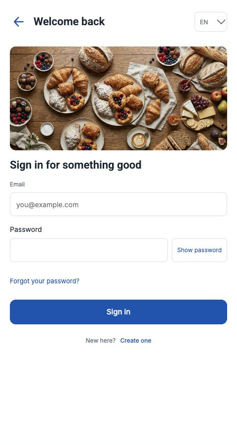

Sign-in opens the appropriate role workspace and preserves allowlisted destinations from order or support links. Salted asynchronous scrypt protects stored passwords; server-side role, ownership and mailbox checks apply after authentication, and logout or credential changes revoke the session.

### Confirm mailbox ownership

Mailbox confirmation requires the matching signed-in account and an explicit confirmation action. The single-use link lasts 24 hours. Successful confirmation invalidates outstanding capabilities and existing sessions, then offers a fresh sign-in. Unverified accounts can browse, but selling and booking actions remain blocked.

### Recover access

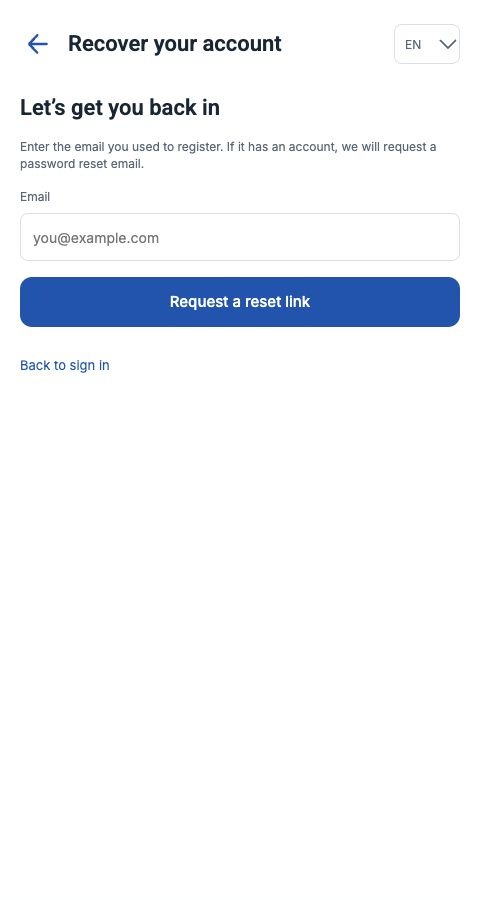

Password recovery sends a single-use link lasting 30 minutes and accepts a new 15–128-character password with repeat confirmation. The recovery response does not reveal whether an account exists. Reset confirms mailbox ownership, invalidates other capabilities and signs out all sessions. The application also submits a password-change notification; a delivery failure cannot undo the reset.

**Delivery boundary:** Brevo sends localized security mail. The configuration stays private; provider acceptance and actual inbox delivery are tested separately. The screenshots contain no passwords or usable email links.

## 1. Find food worth collecting

### Discover meals and surprise bags

The catalogue distinguishes a specific meal from a surprise bag. Buyers can search and filter the available offers, then explore approved cafés nearby through a map or address list. Location access is explicit; a map outage does not remove the list-based discovery path.

**Behind the screen:** the backend filters by current approval, availability and pickup deadlines. Nearby search uses actual café pickup coordinates; ordinary offers do not invent a distance.

### Choose a practical pickup location

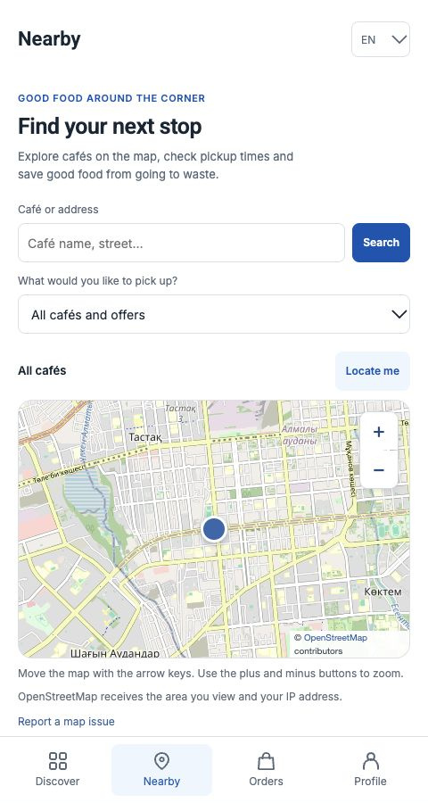

Nearby discovery combines a selected area, radius and a list of approved cafés. Buyers can request one-time browser location or choose an area manually. Cafés without coordinates remain available by address; marker and card selection stay connected.

**Behind the screen:** the café pickup point is part of its moderated profile revision. Search coordinates are transient, distances use geographic calculations and no buyer location is persisted as account data.

### Understand the offer before booking

The offer page brings together the discounted price, original price, guaranteed contents, allergens, quantity and pickup instructions. A surprise bag still states what the café guarantees, so uncertainty about the exact selection does not hide the important terms.

**Behind the screen:** all three offer translations are stored. Booking creates an immutable snapshot, so later edits cannot change what the buyer originally agreed to collect.

### Check the café

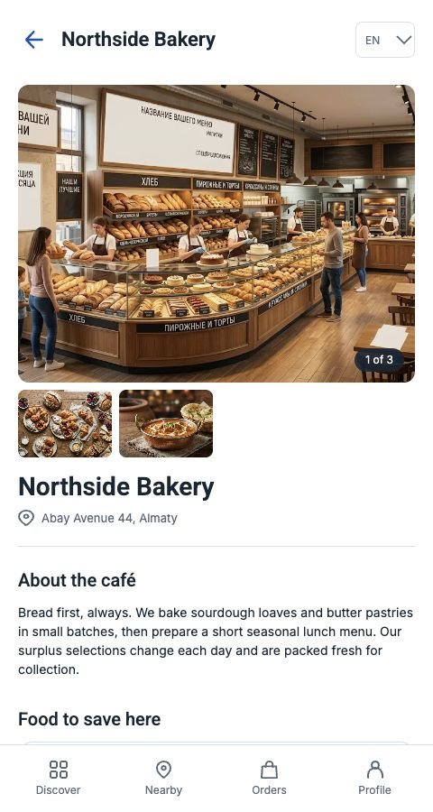

The public café page shows an ordered photo gallery, description, seven-day opening schedule, collection instructions and current offers. The pickup point can open directions without including the buyer's location.

**Behind the screen:** only approved cafés publish a public page. Private owner contacts, application reasons and moderation history stay outside its DTO.

## 2. Reserve, confirm and collect

### Reserve available stock

The buyer selects a quantity and receives a hold lasting up to five minutes, capped by the original pickup deadline. The confirmation screen states the pickup window and payment-at-pickup terms. Expiry releases an unconfirmed hold; confirmation creates a booking.

**Behind the screen:** stock checks and reservation creation happen in one SQLite transaction. The client saves the original request before sending it; a lost response is retried with the same payload and attempt key.

### Keep a clear pickup ticket

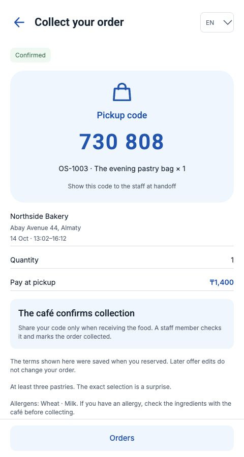

The order screen carries the café, collection window, original offer terms and a private six-digit pickup code. The buyer can follow the order state and open a conversation from the booking. Cancellation and collection controls depend on the server's current state and the original time window.

**Behind the screen:** confirming a booking does not record a card charge. Handoff is a separate operation, available only to the authorized venue inside the pickup window. Uncollected bookings close at their original deadline.

### Keep the order history

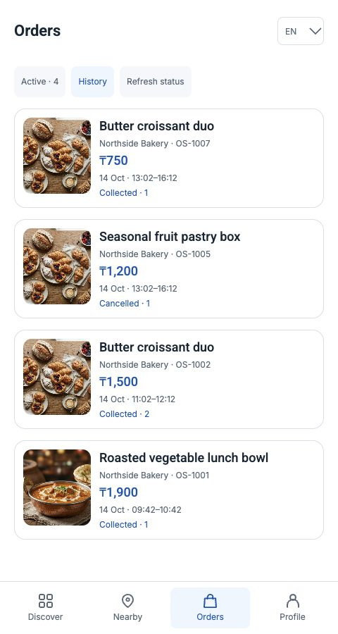

The order list brings current bookings and terminal outcomes back into one account history. Buyers can reopen the original ticket, inspect retained terms and reach the associated conversation after collection or cancellation.

**Behind the screen:** the order lifecycle is independent of the support case. Expiry, cancellation, collection and an unrecorded pickup have distinct states, and original snapshots survive later offer or café edits.

### Follow updates

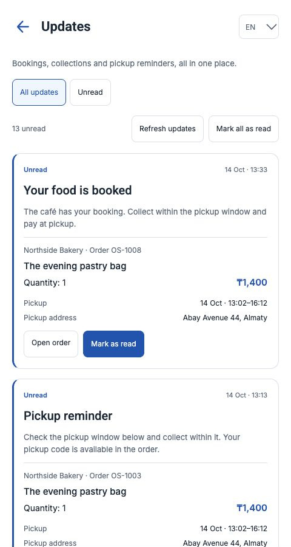

The inbox keeps confirmed, cancelled and collected order events in one place, with unread filtering, read markers and links to the matching authenticated order. Email preferences and language are stored per account.

**Behind the screen:** order changes, notifications, reminder schedules and order-email jobs commit together. A dedicated worker checks reminders and dispatches bounded mail retries without requiring an open browser.

## 3. Get help when an order needs attention

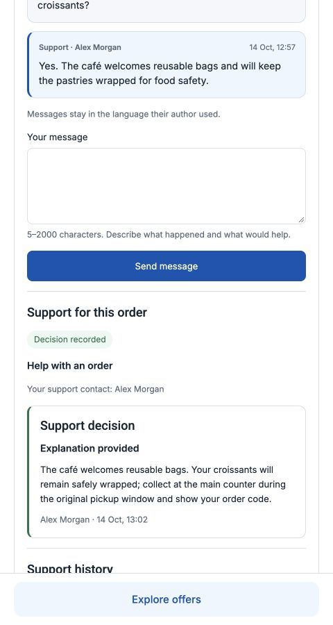

The buyer can message the café about an existing booking, resolve or reopen the conversation, and escalate it for help or as a complaint. Both order participants can read the shared conversation, support outcome and action history.

**Behind the screen:** access follows current buyer/venue ownership. A support case has its own state, assignment and revision; it does not silently change inventory, fulfilment or payment.

## 4. Operate a café

### See the work that needs attention

The café workspace connects active offers, stock, bookings and conversations that need a reply. Owners can move from an overview to the specific offer or booking instead of managing each part in a disconnected tool.

**Behind the screen:** venue scope is enforced on the server. An owner cannot gain access to another café by changing a route or request field.

### Manage availability

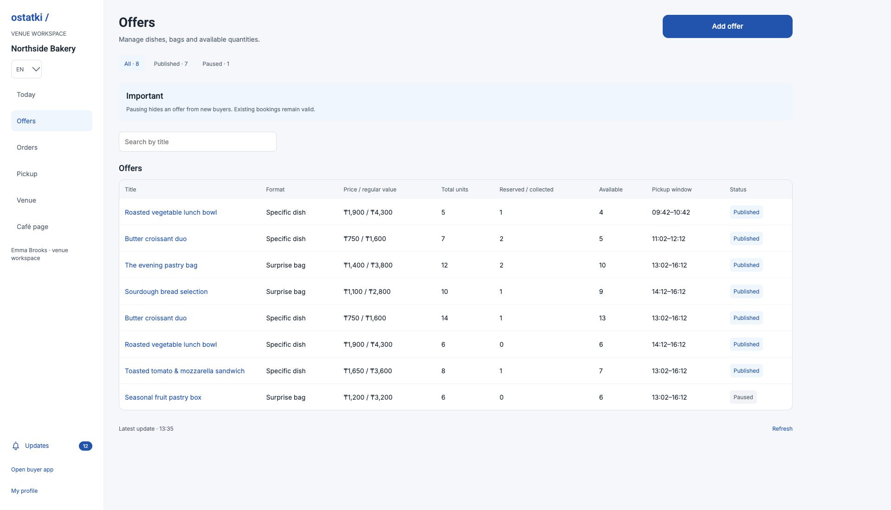

The offer list supports stock, price and pickup-window changes plus pause/resume. Owners can stop new reservations when a product is unavailable while retaining the terms of already confirmed bookings.

**Behind the screen:** absolute offer edits do not rewrite old order snapshots. A café cancellation records a reason and pauses the affected offer atomically; it does not cancel other confirmed bookings.

### Edit an offer without rewriting bookings

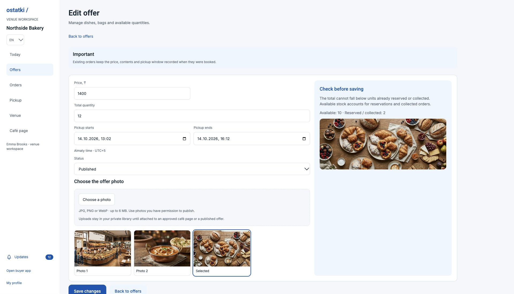

The editor updates a photograph, stock, price and collection times while preserving earlier bookings. The separate creation flow requires allergens, guarantees and English/Kazakh/Russian content as well. Both forms keep the action's request state separate from its visual fields.

**Behind the screen:** keyed offer creation replays the original result; absolute edits repeat the same saved assignments. Saved attempts survive a lost connection, reload and later authentication/rate-limit failures. Server validation requires all three translations when creating an offer.

### Maintain the café page

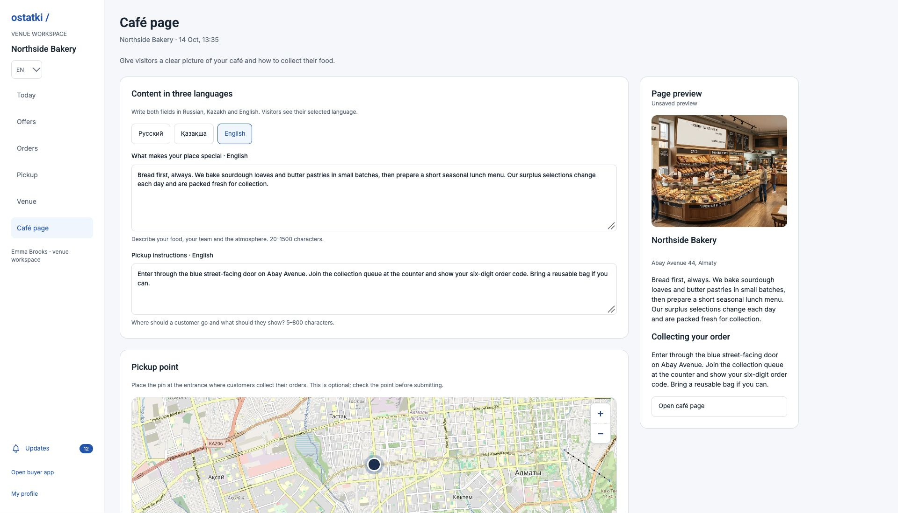

Owners upload photos into a private library, choose up to eight gallery images, arrange a cover and edit the profile's translations, weekly hours and pickup location. The application preserves an unsaved draft when fresh server data conflicts with it.

**Behind the screen:** Sharp checks decoded image content, rejects unsupported or animated images, normalizes orientation and writes metadata-free WebP files. A profile submission creates a new immutable review snapshot and returns the venue to moderation.

<strong>Gallery selection and cover photograph</strong>

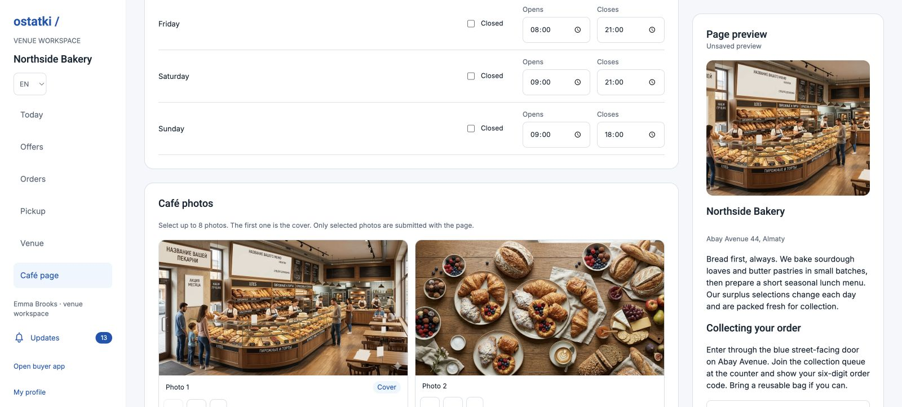

The selected gallery is separate from the private upload library. Only selected photographs enter the profile submission; the first selected photograph becomes its cover.

### Confirm the physical handoff

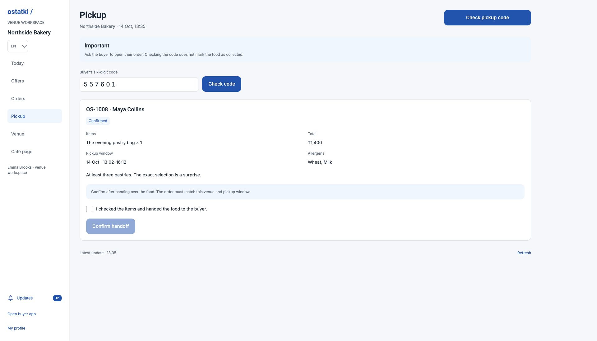

The pickup desk looks up the buyer's code, shows the matching order and requires an explicit handoff confirmation. Looking up a code does not collect an order. A terminal result prevents another handoff.

**Behind the screen:** collection checks the current venue, role, staff scope, order state and original time window. Retrying the same successful action returns its recorded result.

<strong>The completed handoff</strong>

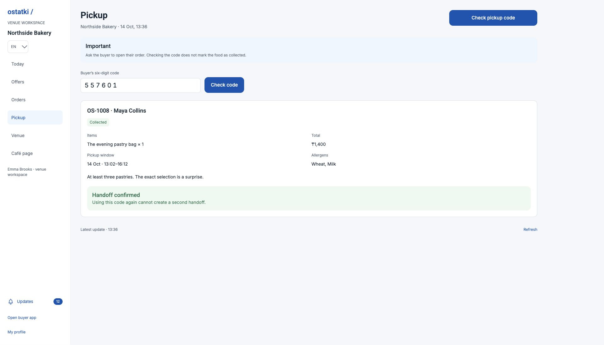

The recorded terminal state remains visible after handoff, and the same code cannot create a second collection.

## 5. Review cafés and resolve cases

### Moderate the exact café submission

The administrator reviews the submitted description, translations, photographs, hours, address and pickup point, then approves, rejects or requests changes with an explanation in all three languages. Past submissions and decisions remain available for review.

**Behind the screen:** revision checks prevent a stale review from approving an owner's newer edit. Suspension stops new sales while already confirmed bookings retain their terms and can still be fulfilled.

<strong>Submission versions and review history</strong>

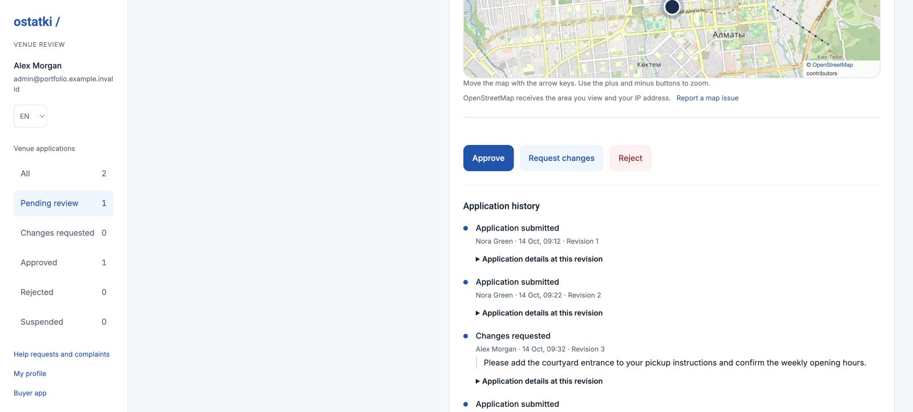

The review history retains application submissions, requested corrections, administrator explanations and their revisions. Each event can expose the application details saved at that version.

### Resolve a support case with a recorded explanation

The support queue offers status/type/assignment filters, search and pagination. An administrator takes responsibility before replying or recording a decision. The explanation is required in English, Kazakh and Russian, and both participants see the outcome and history. A later buyer message can reopen the case without erasing the previous decision.

**Behind the screen:** current administrator permissions, exclusive assignment and revision checks protect every action. Administrator order details omit the pickup code. A decision records the outcome without claiming to process a refund or perform financial settlement.

<strong>Order and support action history</strong>

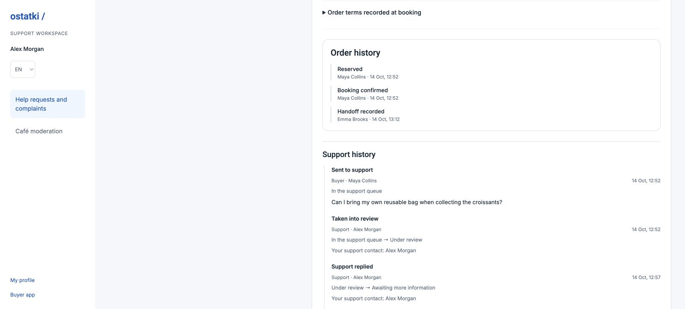

Order fulfilment and support have separate histories. The case records escalation, assignment, replies and decisions while the order retains its original reservation, confirmation and handoff events.

## Engineering scope

| Area                | Delivered                                                                                                                  |
| ------------------- | -------------------------------------------------------------------------------------------------------------------------- |
| Frontend            | Next.js 16 App Router, React 19, TypeScript, CSS/CSS modules, self-hosted fonts and FSD boundaries                         |
| Backend             | Node.js 24 HTTP routes, runtime validation, focused marketplace use cases and native SQLite infrastructure                 |
| Identity            | Salted asynchronous scrypt, revocable cookie sessions, mailbox confirmation and password recovery                          |
| Transactions        | Atomic stock, five-minute holds, immutable order snapshots and actor/payload-bound retries                                 |
| Operations          | Café onboarding, revisioned moderation, handoff, conversations, support assignment and decision history                    |
| Localization        | RU/KK/EN UI, content, errors, transactional mail and persisted explanations                                                |
| Media and discovery | Authorized uploads, private photo storage, public approved café pages and map/radius search                                |
| Background work     | Persistent notifications, reminder scheduling, email preferences and a supervised retry worker                             |
| Verification        | 172 recorded passing tests, strict TypeScript, lint, formatting, dependency guard, production build and browser regression |

The frontend uses downward FSD imports and public slice entries. Business rules and trust decisions stay in server modules. The server remains a modular monolith: narrow collaborator contracts separate use cases from SQLite without obscuring their transaction boundaries.

The app currently uses payment at pickup, one durable SQLite disk and private local photo storage. Online payments/refunds, support emails and public hosting/backups are separate release work.

[View the repository and local setup](../README.md) · [Read the architectural decision](adr/001-fsd-and-modular-backend.md) · [Inspect the verification evidence](verification.md)
